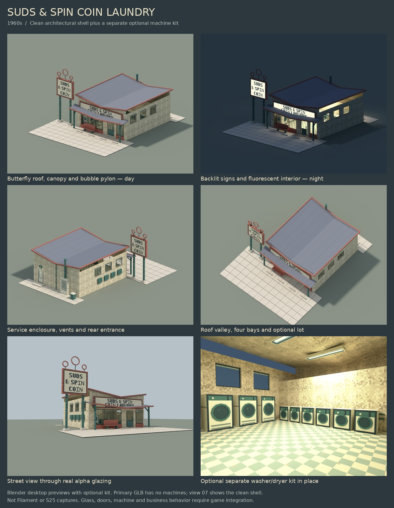

# Suds & Spin Coin Laundry

An original **1960s roadside laundromat**: a shallow butterfly roof, folded entrance canopy, coral tile sills, teal framing, large glazed storefront and a double-sided bubble-topped pylon. The rear has a staff entrance, service enclosure, flue, valley downpipe and dryer vent hoods. Four parking templates, an outside bench and rear bin finish the lot.

**The primary `coin-laundromat.glb` is a clean architectural shell, without machine meshes.** The supplied **`laundry-fixtures.glb` is a separate optional, already-positioned visual kit** containing six washers, four single-height dryers and one coin cabinet. The kit is shown in review views 01–06; view 07 shows the same interior with the kit hidden. This preserves the guide's clean-shell contract while providing real 3D machine geometry for review or optional integration.



**Actual Blender desktop previews, not Filament game or S25 captures.** Transparent glazing, doors, furniture/machine binding and laundry/business simulation remain integration work. No residents, laundry loads, machine prices, fees, timers or operating states are created.

## Files and rebuild

- `coin-laundromat.glb`: primary self-contained glTF 2 binary, metres, Y up, public entrance +Z. Origin at grade at the middle of the front wall.
- `laundry-fixtures.glb`: optional aligned fixture kit, in the same metres/Y-up coordinates. Import it at the building origin, without another floor-height offset.
- `coin-laundromat.blend`: editable source containing both roots, packed textures and review staging, saved at the daytime front camera. Presentation lights/terrain/cameras are excluded from both exports.
- `build_laundromat.py`, `make_art.py`, `mesh_helpers.py`, `pixel_font.py`: deterministic original geometry/art sources.
- `model-info.json`: primary rooms, doors, sign region, machine-slot references, parking templates and collider boxes.
- `fixtures-info.json`: optional fixture node IDs, budgets, placement and separate collider boxes.
- `art-regions.json`, `validate_model.py`, `validation.json`: exact pixel regions and checks of both actual exported files.
- `renders/`: day, blue hour, rear, above, person height, furnished-kit interior and primary-only shell; raw and noise-cleaned PNGs. `preview.html` links all seven views and both GLBs.

From this directory inside the repository, with Blender 4.3 and Python/Pillow/numpy:

```sh
python make_art.py
blender -b -t 4 -P build_laundromat.py
python validate_model.py
```

`-- --review` renders small checks; `-- --shots=01-front-day` selects views; `-- --shots=none` exports both files and packed source without rendering. `-- --shell-only` hides the optional kit in review images, without changing the clean primary export. Optional `finish_renders.py` uses OIDN 0.2.1 to remove sampling noise; it does not invent model details. `package_preview.py` builds the review sheet, gallery and local ZIP. No illumination is baked into textures.

## Architecture and machine treatment

The main building is **9.93 × 11.17 m**. The butterfly roof trim reaches about **5.51 m**, service flue **6.13 m**, and pylon crown **9.43 m**. The allocated lot envelope is **18.62 × 21.11 m**, including space around the concrete courts. The four bays are approximately **2.48 × 4.97 m**, stopping before the entrance walk. They are placement templates, not a traffic or turning-clearance simulation.

The public and service-room floors are **0.1552 m** above grade, matching all three door anchors (two exterior and one internal staff-room entrance). The public shell has a fixed wall folding ledge, two washer service rails and wall ports. These are architectural fittings, not loose furniture. The service room has its own ceiling, entrance and external utility enclosure. The model supplies no interior chairs, movable folding tables or baskets.

The kit has **six front-loading washer fixtures, four single-height dryer fixtures and one coin cabinet**. The circular rims and recessed empty drum faces are actual low-sided geometry; controls and cabinet seams are original pixel art. Each fixture is below 500 triangles. These are static fixtures: no drum/door animation, washing/drying logic, billing, prices, inventory, water, heat or electrical behavior is implemented.

Choose **either** the optional kit **or** the game's own furniture at the eleven `slot_*` anchors. Do not place both sets. The slots record floor height, kind and outward direction. The kit's groups already carry their geometry in building coordinates; they are not separate origin-normalized reusable appliance assets. A developer needing per-machine animation must supply suitable pivots and state bindings. The slot references themselves spawn nothing.

[Interior with optional kit](renders/06-interior-clean.png) · [Primary shell alone](renders/07-clean-shell-clean.png)

## Glazing, signs and runtime handoff

The storefront uses actual alpha PNG panes with opaque pixel frames and bubble decals. Blender can show the separate machines through those panes. The current landmark importer may require a dedicated transparent-glass treatment; its opaque material-role shader must not be assumed to show the kit. Do not bake machine images into the window textures to imitate working transparency.

The exact `sign_name` mesh/material uses **`[0,0,112,18]` art pixels** of `textures/signs.png`, with the fictional SUDS & SPIN / COIN LAUNDRY preview title. The pylon uses another region of the same texture. A runtime name writer must edit only the front masthead region and preserve whole 2 × 2 texel pixels without stretching. Actual naming and opening/closure facts belong to the simulation. Backlighting in the previews is visual staging, not an operating-state binding.

Primary architectural contact uses **“use the walls”**, floors and closed panels, plus **16 full-height companion boxes** for posts, the fixed ledge, service fittings and yard props. The optional kit has **11 matching fixture boxes** in its own metadata. Each GLB exports its own hidden `collision` node; the Blender source distinguishes `collision` from `collision_fixtures`. Keep the two model/metadata contexts separate when loading, and hide collision meshes when drawing.

Opening/hiding a `panel_door_*` requires disabling its matching `gate_node` box and restoring both when closing it. Dropping the optional kit must also drop its collider boxes. If using game furniture, use that furniture's collisions instead. Door transitions, glass shading, utility/machine bindings and business simulation require developer integration.

`lot` contains the concrete courts, parking marks/stops, outside bench and bin. These can be dropped with their attached boxes. Structural posts, the pylon, fixed ledge, service fittings and rear landing remain with the building. Town placement must provide ground at grade when omitting the lot.

## Art and validation

The primary shell has **1,898 visible triangles**, the optional kit **1,214**, for **3,112 combined** and **twelve unique materials**. Meshes are merged by material within the building, sign, door, prop and machine assemblies. The name panel and individual fixture groups remain addressable.

Both files embed exact **2 × 2 texel art-pixel PNGs**, mapped at **0.0388 m per texel**, with nearest/repeat sampling. Shared LimeZu `wall_stucco_red` (retinted cream), `roof_membrane_grey` and `pavement` swatches supply the base materials; original cuts and source provenance are retained. They are licensed for Timerpg game use only and require the original credit. Other geometry, signage, glass decals, checker floor, cabinets and machine faces are original.

Validation reads both GLBs and checks clean-shell separation, all eleven slot mappings/orientations, fixture coverage by full-height colliders, per-prop budgets, pixel blocks/physical UV density, actual glass alpha, roof/gable normals, clear doorways, non-overlapping paving and parking, and the exact five parking-stripe boundaries. It does not claim functional laundry gameplay or Filament/S25 performance.
