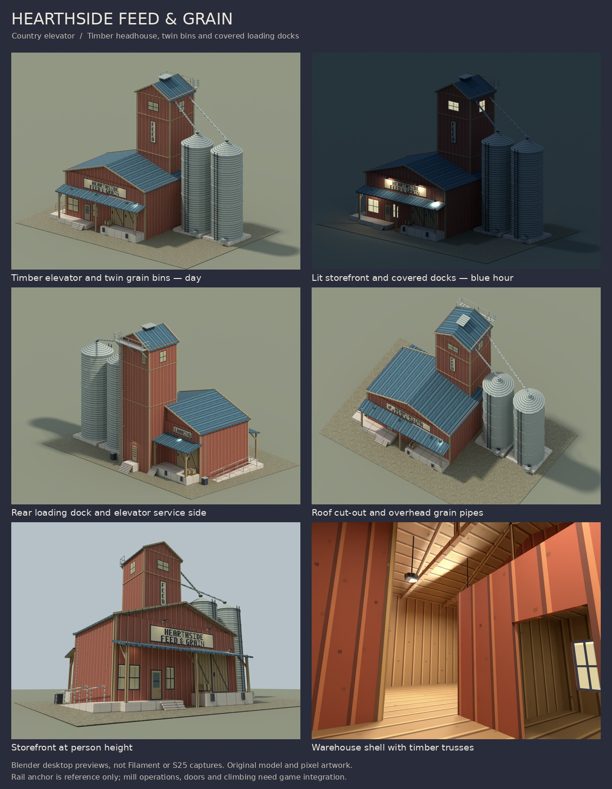

# Hearthside Feed & Grain

An original small-town American feed mill and country grain elevator: a **20 m timber headhouse**, a broad gabled feed-store/warehouse wing, **two galvanized grain bins**, real overhead gravity pipes, covered front and rear loading docks, and a rear machinery landing with a fixed ladder. Weathered red timber, slate-blue sheet roofing, timber corner/belt boards and original pixel lettering give the complex a distinctive silhouette from every side.

The shop has a lower entrance, porch, steps, a service-cart ramp and a fixed counter. The warehouse has a higher floor, three internal steps from the shop, large sliding loading doors, timber trusses and pendant fixtures. The headhouse is an enclosed maintenance shaft with high windows, a ventilator, service landing and separate closed door. Exterior sacks/pallets and bins are removable lot dressing. No loose indoor furniture, workers, vehicles or milling machinery are baked in.

Typical original construction **1920–1960**, suitable as a standing business, preserved landmark or future reuse from 1950 onward. Actual ownership, opening/closure, work and goods must follow the town simulation. Hearthside is a fictional preview business name.



**Actual Blender desktop previews, not Filament game or S25 captures.** Rail, mill operations, business naming, doors and climbing remain runtime integration work. No operational railway is assumed.

## Model and rebuild

- `feed-mill.glb`: self-contained glTF 2 binary, metres, Y up, public entrance towards +Z. Origin at grade in the middle of the main building's front edge. Source construction coordinates are uniformly shifted +24 art pixels on X for export; `model-info.json` gives the actual exported coordinates.
- `feed-mill.blend`: editable source with packed textures, saved at the daylight front camera. Presentation terrain, cameras and lights are excluded from the GLB.
- `build_mill.py`, `mesh_helpers.py`, `make_art.py`, `pixel_font.py`: deterministic original geometry/art sources.
- `art-regions.json`: exact whole-art-pixel panel regions, including doors, windows and lettering.
- `model-info.json`: rooms/floor levels, four entrance anchors, closed door panel IDs, two bin assemblies, sign region, collision handoff and a reference-only future rail anchor.
- `validate_model.py`, `validation.json`: checks on the exported buffers, materials, physical UV scale, roof cut-out, non-overlapping paving tops, doors, bins and collider.
- `renders/`, `mill-review.jpg`, `preview.html`: day, blue hour, rear, above, person-height and warehouse-shell views, with raw and noise-cleaned PNGs.

From this folder in the repository, using Blender 4.3 and Python/Pillow/numpy:

```sh
python make_art.py
blender -b -t 4 -P build_mill.py
python validate_model.py
```

`-- --review` renders small checks; `-- --shots=01-front-day` selects views; `-- --shots=none` exports GLB and packed source without rendering. Optional `finish_renders.py` uses OIDN 0.2.1 to remove sampling noise; it does not invent or alter geometry. `package_preview.py` produces the local review bundle. The interior view also uses a presentation fill light to reveal the shell; no illumination is baked into textures.

## Architecture and floor levels

The gravel yard is approximately **29.80 × 19.87 m**. The main front spans **13.66 m**; its warehouse roof ridge is **9.16 m** high. The headhouse rain hood reaches approximately **20.00 m**, and the grain-bin hatches **14.20 m**. Each bin has a 2.17 m radius. The warehouse roof is physically cut around the elevator shaft, with no roof left inside it. The loading canopies have real supporting posts and knee braces; the upper landing is braced to the shaft. Grain pipes meet wall outlets and bin hatch inlets.

The shop entrance/floor is **0.6208 m** above grade, with four 0.1552 m steps and a 1:12 service-cart ramp. The warehouse, loading doors, rear docks and shaft service door use a **1.0864 m** floor. Three internal steps connect the shop to the warehouse. Floor levels and outward door orientations are recorded in metadata; stairs/ramps need actual elevation-aware traversal in the game. These dimensions are model geometry, not an accessibility certification.

The exact `sign_name` mesh and material are separate from the front wall. It uses `[0,0,96,18]` art pixels of `textures/signs.png`, with original HEARTHSIDE / FEED & GRAIN lettering. The same material also carries a separate vertical FEED panel and rear LOADING label in other regions. Runtime name writers must edit only the front region, retain whole 2 × 2 texel blocks and fit text without stretching. No business-name binding is implemented.

## Railway handoff

`anchor_rail_dock` is **reference only**, at exported glTF `[-3.4144, 0, -12.7264]` metres, with a proposed siding tangent along +X. The rear platform edge is at source/export Blender Y = 144 art pixels, and the dock surface at 1.0864 m above ground.

No rail, train, connection or rail loading operation is baked into the GLB. The railway is unfinished. Before connecting this building, the developer must resolve the actual track centreline, railway gauge and rail-head height, freight-car loading height, platform gap, clearances, placement, navigation and simulation operations. The anchor does not reserve land or create a siding by itself.

## Collision, doors and lot groups

The guide permits **“use the walls.”** Architectural walls, floors, ramps and closed sliding/person-door surfaces provide structural contact; the hidden `collision` mesh and **26 full-height companion boxes** cover the grain bins, their ladders/blowers, canopy posts, downpipes, counter, dock bumpers, elevator ladder and lot props. Boxes start at grade and have explicit group/attachment IDs. Validation checks that each grain-bin assembly is covered by its boxes and that every box matches the actual exported collision mesh.

Hide `collision` when drawing the asset. Open/hide each `panel_door_*` and disable its matching `gate_node` box together; restore both when closing it. The shaft/upper landing and fixed ladders are not climbable until detailed height collision and navigation are implemented. Stair, ramp and dock contact must use actual elevation surfaces; flat walk cuts alone cannot implement them.

`lot` contains the gravel yard, pallet/sack groups and service bins. These can be dropped with their attached boxes. The building, docks, access ramp, fixed counter, pipes and bin foundations remain with the structure. Dropping `lot` requires the town's own ground surface at grade. No public road or railway land is included.

## Art and validation

**6,119 visible triangles, twelve materials, four external doors and two separately addressable grain-bin assemblies.** Meshes are merged by material within their logical assemblies; name panels, closed door groups and removable props remain addressable. Exterior pallet/bin props are below 500 triangles each.

All embedded PNGs use exact **2 × 2 texel art pixels**, nearest/repeat sampling and **0.0388 m per texel** UVs, without stretching. Shared LimeZu `brick_red`, `roof_tin_blue` and `pavement` swatches provide the base materials. The roof swatch is retinted to weathered slate blue while retaining its pixel grid; original cuts and provenance are included in `source-materials/`. These shared swatches are licensed for Timerpg game use only and require the original credit. Geometry, timber/steel/gravel details, doors, windows, signs and sack graphics are original.

Runtime mill/utility operations, jobs, inventory, town-name binding, railway behavior and climbing are not implemented. No S25 performance or Filament capture is claimed.
