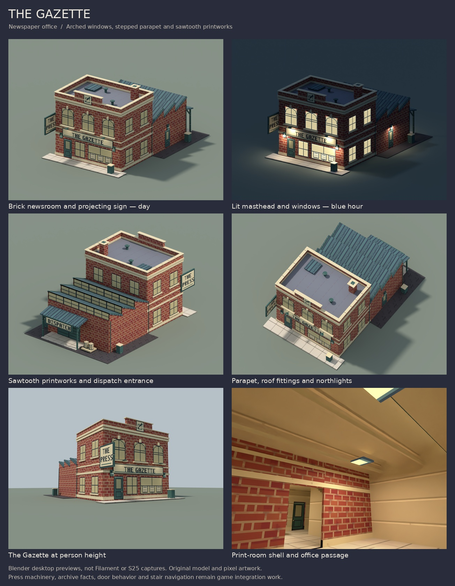

# The Gazette Office & Print Shop

An original two-storey small-town newspaper office with a rear industrial print-room wing. The brick street front has a stepped stone-capped parapet, a paper/quill emblem, arched upper windows, a separate **`sign_name` masthead**, newspaper display glazing and a double-sided projecting PRESS sign. The back is fully designed: three sawtooth roof bays with northlight glazing, a covered dispatch entrance, paper-roll pallet, downpipes, roof vents, chimney and service fittings.

Typical original construction **1905–1940**, suitable as a standing newspaper office from 1950 into the present. The Gazette title is a static fictional preview; no archive content, residents, jobs, ownership or publication history is created. The simulation must supply those facts.



**Actual Blender desktop renders, not Filament game or S25 captures.** This is a model handoff. Door behavior, upper-floor/stair navigation, actual printing machinery and Gazette simulation bindings remain game integration work.

## Source and rebuild

- `gazette-office.glb`: self-contained glTF 2 binary, metres, Y up, public entrance +Z. Origin at grade at the middle of the main front masonry edge.
- `gazette-office.blend`: editable source with packed PNGs, saved at the daylight front camera. Presentation terrain, cameras and lights are excluded from the GLB.
- `build_gazette.py`, `make_art.py`, `mesh_helpers.py`, `pixel_font.py`: deterministic original geometry and pixel art.
- `model-info.json`: room levels, three entrance anchors, door panels, stair geometry, exact masthead region, press reference anchor and full-height collider boxes.
- `art-regions.json`: physical art-pixel regions for the window, door, paper and sign panels.
- `validate_model.py`, `validation.json`: checks on the actual exported buffers and embedded image bytes.
- `renders/`: front/day, blue hour, rear, above, person height and print-room shell; raw and noise-cleaned PNGs. `preview.html` is a local gallery.

From this directory inside the repository, with Blender 4.3 and Python/Pillow/numpy:

```sh
python make_art.py
blender -b -t 4 -P build_gazette.py
python validate_model.py
```

`-- --review` renders small checks; `-- --shots=01-front-day` selects views; `-- --shots=none` exports the GLB and packed source without rendering. Optional `finish_renders.py` uses OIDN 0.2.1 to remove sampling noise without inventing geometry; `package_preview.py` creates the contact sheet, gallery and local ZIP. No illumination is baked into textures.

## Rooms and architecture

The masonry footprint is about **9.93 × 14.28 m**, with the front office occupying the first 6.83 m of depth. The main roof/parapet reaches 9.39 m, chimney 9.56 m, and print-room roof 5.59 m. The lot envelope is 13.66 × 19.09 m; metadata also gives exact bounds for the sign/canopy overhangs. Town placement must preserve street-side overhead clearance.

The ground-floor public office has a fixed subscriptions counter and display windows. Its floor and all three exterior entrances are at **0.1552 m**. A real U-shaped staircase has **24 risers of 0.1552 m** and 0.2328 m treads: two flights and a half landing reach the **3.88 m** editorial floor. The upper floor is cut around the stairs, with a top landing and guardrails. Interior rooms remain clean shells; the game supplies desks, filing cabinets, archive shelves and other loose furnishings.

The rear print room has three real sawtooth roof bays, glazed northlights and a low integral press foundation. **`anchor_printing_press` is a reference only**, at the top of that base, 0.2328 m above grade. It does not create a machine or print newspapers. Add appropriately sized machinery through the game's furnishing system after resolving placement, collision and operating behavior. Rear paper rolls are optional exterior dressing, not simulated inventory.

The exact **`sign_name`** mesh and material remain separate from the facade. The masthead occupies **`[0,0,100,14]` art pixels** of `textures/signs.png`. Edit only that region, preserve the other emblem/blade/dispatch regions, and keep whole 2 × 2 texel pixels without stretching. Runtime business/town-name binding is not implemented. Window newspapers show generic graphic columns, with no invented headlines or dated facts.

## Collision and runtime handoff

The guide permits **“use the walls.”** Architectural walls, floors, stairs and closed panels supply structural contact. A hidden `collision` mesh and **15 full-height companion boxes** cover closed doors, the fixed counter, press base, dispatch posts, downpipes and removable yard props. Their centres, sizes, groups and attachments are recorded in metadata. Hide the collision mesh when rendering the GLB.

Opening or hiding a `panel_door_*` requires disabling its matching `gate_node` box, and restoring both when closing it. Floor anchors and outward directions are verified, but flat walk cuts alone do not implement the staircase, upper floor or foundation step. Height-aware collision, room transitions, head clearance and navigation remain developer integration work. The projecting sign is wall-mounted above walking height; it is not a ground-level obstruction.

`lot` contains the front pavement, rear asphalt, newspaper box, service bins and paper-roll pallet. These can be dropped with their attached boxes; the building, press foundation and dispatch apron remain structural. The town must provide its own ground at grade when dropping the lot.

## Art and validation

**3,066 visible triangles, twelve materials, three exterior entrance anchors and fifteen collider boxes.** Geometry is merged by material within the building, stairs, projecting sign, door and removable prop assemblies. The masthead remains addressable. Each optional exterior prop is below 500 triangles.

All embedded PNGs use exact **2 × 2 texel art pixels**, mapped at **0.0388 m per texel** with nearest/repeat sampling. Shared LimeZu `brick_red`, `roof_membrane_grey`, `roof_tin_blue`, `pavement` and `asphalt_worn` swatches supply the base materials; the metal roof is retinted to weathered slate blue. Original cuts and source provenance are retained in `source-materials/`. These swatches are licensed for Timerpg use only and require original credit. Other geometry, signs, doors, windows, newspaper graphics and trim textures are original.

Validation checks physical UV scale, embedded PNG blocks, degeneracy, exact door anchors, clear plinths at the public/internal passages, actual stair tread heights, the upper-floor stair aperture, non-overlapping paving tops, collider/metadata agreement and prop budgets. It does not claim Filament/S25 performance or functional printing/gameplay.
