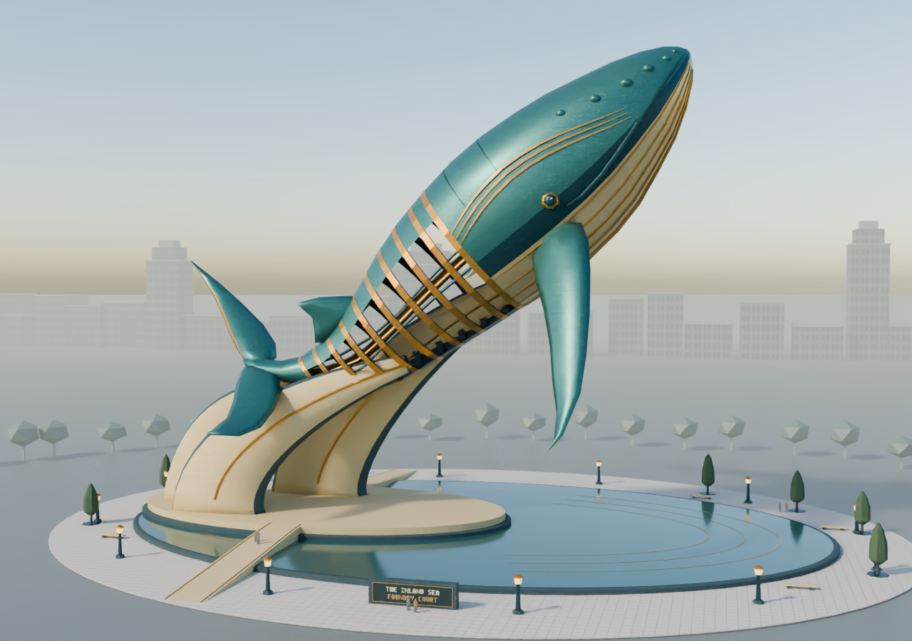

# The Inland Sea

A 71.83 m bronze humpback breaches above Foundry Court. Its head carries chased cheek lines and a pale, fluted throat. Follow the body toward the tail and the skin opens into ten transverse frames around a lit keel. Three limestone breakers carry the sculpture down to a single island. Visitors can cross the oval basin on two gently rising causeways and look up through the hull.

[Seven-second orbit](orbit.mp4) · [Eight camera views](review.jpg) · [GLB](inland-sea.glb) · [Packed editable Blender file](inland-sea.blend)

## Model

Original civic sculpture for a large urban parcel from the 1930s onward. The model is 130 × 100 m in plan and contains 11,842 visible triangles, 11 materials and 10 embedded pixel textures. The front edge of the promenade is at the origin. The GLB uses metres, Y up and +Z toward the front. The park has two outdoor approaches. Lanterns, benches and cypresses are separate removable groups under `lot`.

The solid head, throat beads, cast eyes, pectorals and flukes are meshes. Light passes through actual gaps between the frames. The GLB contains a static water surface. Use the architectural surfaces for collision and supply the water boundary and night lights in the engine. Measurements and handoff details are in [model-info.json](model-info.json).

## Rebuild and review

1. From this directory, run `python make_art.py` with Pillow. The promenade uses the repository's Timerpg-only LimeZu pavement swatch. The other pixel textures and sculpture are original.
2. Run `blender -b -t 2 --python-exit-code 1 --python build_model.py -- --shots=day,night,rear,above,person,portrait,shore,underneath` with Blender 4.3. The script saves the GLB and packed source, then renders desktop views to `/tmp/inland-sea-raw`.
3. Run `python finish_renders.py` with NumPy, Pillow and the Python oidn 0.2.1 binding. Run `python package_review.py` with Pillow 10.1 or later.
4. To regenerate the orbit, run `blender -b --python-exit-code 1 --python render_orbit.py`, then `python encode_orbit.py` with the same OIDN dependencies and FFmpeg.
5. Run `python validate_model.py` and `blender -b --python-exit-code 1 --python check_bearings.py`. These inspect the exported file, including all three sculpture-to-pier intersections and the support below each pier foot.

The published GLB also passed Khronos glTF Validator 2.0.0-dev.3.10 with zero errors and zero warnings. The images and orbit are Blender desktop renders. The distant city, scale figures and lighting rig are presentation elements in the Blender scene. Filament integration and S25 testing are pending.
