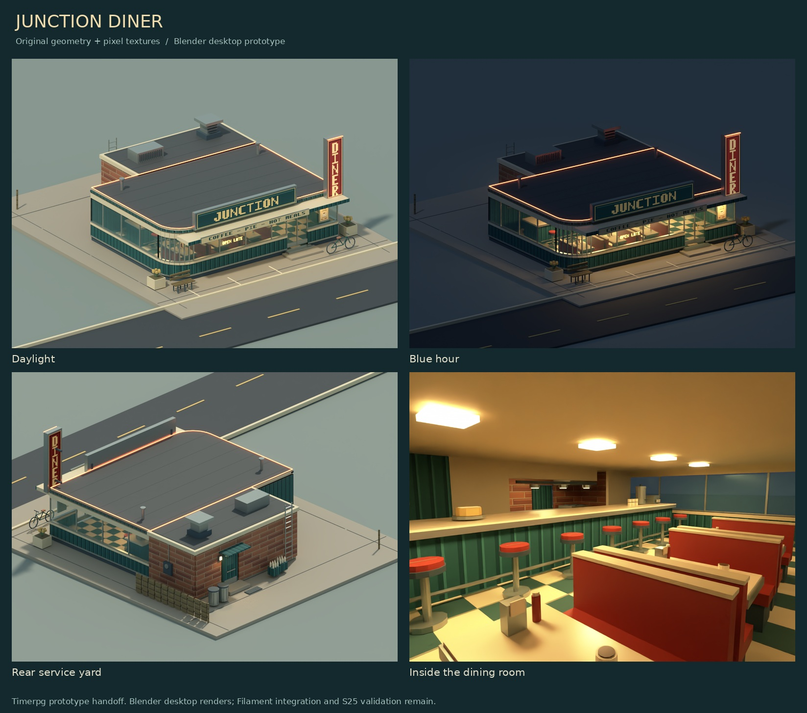

# Junction Diner

An original Timerpg building study: rounded teal-and-cream enamel frontage, coral roofline lighting, a double-sided vertical DINER sign, red booths, checkerboard linoleum, a furnished counter, a brick kitchen, and a finished service yard.

All building geometry, props, lettering, and pixel textures were made from scratch for this prototype. No downloaded building models or stock texture packs are used.



[Daylight](renders/01-day-front-clean.png) · [Blue hour](renders/02-blue-hour-clean.png) · [Rear service yard](renders/03-rear-service-clean.png) · [Interior](renders/05-counter-detail-clean.png)

## What is included

- `junction-diner.blend`: editable Blender 4.3 scene with packed textures, individually named parts, a closed roof, interior, lighting, and a daylight camera.
- `export/junction-diner.glb`: portable, material-batched mesh with embedded nearest-filtered textures: 11,620 triangles in 26 mesh/material groups, about 0.93 MB. Metres; glTF Y-up; the entrance faces positive Z after export. Includes the lot dressing and presentation road strip; the large surrounding ground backdrop is excluded.
- `textures/`: original PNG pixel textures and signs.
- `renders/`: actual desktop renders of this model, including daylight, blue hour, rear service yard, and an interior camera. Files ending in `-clean.png` use standard CPU Open Image Denoise to remove render sampling noise.
- `make_textures.py`, `build_diner.py`, `export_model.py`, `finish_renders.py`: reproducible sources.

These are Blender desktop prototype renders, not captures from the Android game, Filament, or an S25. The asset has not been integrated into Timerpg or measured on a phone. Scene lights are in the Blender file; engine lighting and transparent-material behavior need review during integration. This is a review handoff; runtime integration remains a separate change.

## Rebuild

Requires Blender 4.3.x and Python with Pillow for the texture generator.

```sh
python make_textures.py
blender -b --python build_diner.py -- --portfolio
```

Omit `--portfolio` to also render the street-eye and overhead views. Use `--draft` for a single smaller daylight preview. An optional `--eevee` renderer switch is available; the delivered images use Cycles.

Optional render denoising uses the pinned Python package `oidn==0.2.1` with its CPU native library:

```sh
python -m pip install --target vendor oidn==0.2.1
python finish_renders.py renders/01-day-front.png renders/02-blue-hour.png renders/03-rear-service.png renders/05-counter-detail.png
```

The source archive excludes the denoiser installation and temporary rendering logs. See `export/model-info.json` for measured mesh counts and dimensions. The export is batched by material to avoid one mesh submission for every small prop; actual draw counts depend on the receiving engine.

## Handoff for Claude

Inspect the four desktop views and the editable scene first. The GLB is an interchange asset; integrate accepted geometry and textures through the existing Filament pipeline. Preserve nearest filtering, double-sided blade lettering, roof and rear details, and warm interior lighting. Translate the metre-based dimensions into the town coordinate system; review lot placement, collision, glazing, emissive materials, and day/night lighting. The export includes a road strip for presentation that should be separated from the town road system.

Acceptance for a game integration should include actual Filament previews from the front, rear and above, and S25 measurements. The Blender images do not establish those results. No game code is changed by this prototype handoff.
