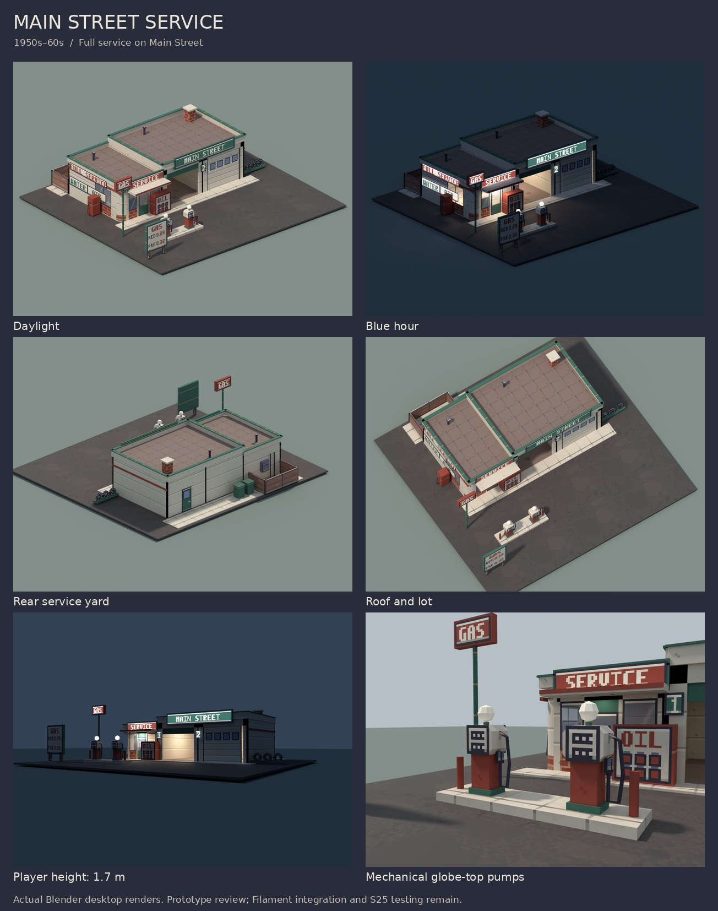

# Main Street Service

An original **1950s–60s full-service station** for Timerpg: a rounded porcelain-enamel office, stepped flat roofs, two repair bays, two mechanical globe-top pumps, a hand-lettered price board, oil and tire displays, and an air/water service point. The back has a service exit, chimney, vents, utility pipes, bins and a small fenced yard.



[Daylight](renders/01-day-front-clean.png) · [Blue hour](renders/02-blue-hour-clean.png) · [Rear](renders/03-back-clean.png) · [Above](renders/04-above-clean.png) · [Person height](renders/05-person-height-clean.png) · [Mechanical pumps](renders/06-mechanical-pumps-clean.png)

## Files and checks

- `main-street-service-station.glb`: self-contained glTF 2.0 binary, metres, Y up, front +Z. The origin is at ground level at the middle of the building's front edge; the office entrance is offset to the left.
- `main-street-service-station.blend`, `build_station.py`, `mesh_helpers.py`, `make_art.py`, `pixel_font.py`: editable source and original geometry/art generators. The construction helpers and bitmap font are reused from the Crossfield workflow; the architecture and period equipment are new.
- `model-info.json` and `validation.json`: dimensions, doors, collision boxes, operating/reuse hooks and actual exported-asset checks.
- **2,372 visible triangles, 12 materials, 212 triangles per pump.** Building wall footprint: 15.52 × 8.07 m. Parcel: 23.28 × 21.73 m. The pump registers sit at about 1.63 m, with globe crowns at 2.56 m.
- Every embedded texture is an exact **2×2 texel art-pixel grid**, at **0.0388 m per texel**. Nearest filtering, real backs and roofs, named doors, a collision-only mesh and optional `lot` hierarchy are present.

These are **Blender desktop previews**, not Filament or S25 captures. This is a prototype asset handoff; runtime integration, placement and phone testing remain separate work.

## Main Street → highway handoff

[Old and new station comparison](station-generations.jpg)

The suggested construction year is 1953 and the design fits 1950–1969. This is an architectural style window, **not an expiry date**: an old station can remain active into later decades.

Crossfield is the separate highway-era asset (`prototypes/modern-gas-station/modern-gas-station.glb`, design 2005+), available on `codex/modern-gas-station` in [PR #3](https://github.com/LifemaxRPG/Timerpg/pull/3). A simulation-recorded relocation may move the business to an eligible highway parcel. Keep the original Main Street building and parcel identity unless the simulation records demolition or reuse. A new competing highway business may instead open while this station stays active. The two models must never independently decide that a business moved, closed or changed owners.

For a recorded **repair-only reuse**, hide `pump_01`, `pump_02`, `roadside_price_board`, and `roadside_fuel_sign`, plus collision boxes whose `attachment` matches those node names. Keep the office and garage. Do not infer that reuse merely from the year. The exact handoff fields live in `model-info.json` under `history_handoff`.

## Runtime details

- Four outward-facing ground-level interaction nodes: `door_main`, `door_back`, `door_bay_1`, `door_bay_2`.
- Bay 1 is open. `garage_door_open` is its raised panel. Bay 2 is closed; `garage_door_closed` contains its body and slatted artwork. Change that node and its collision record (tagged `gate_node`) together when opening it. Office and garage floors are at entrance level.
- `collision` must not render. It has `collision_only: true` / `render: false` extras. Metadata box centres use Blender Z-up; convert `(x,y,z)` to glTF `(x,z,-y)`, and sizes to `(x,z,y)`. Optional lot collisions are tagged `lot`.
- The interior is a clean office/service-bay shell with a fixed counter. The game supplies loose furniture, people and vehicles.
- `sign_price` is an independent, full-UV material/node with a 32×40 texture. `price_art.write_prices(path,year,regular,premium)` updates the two hand-lettered rows without changing fixed grade labels. Example values for 1959 are illustrative, not a historical pricing dataset. The legacy sign format accepts 0.00–9.99; a different sign layout is needed above that range.
- Preview lights and background scenery are excluded from the GLB. `glass_*` and `glow_*` identify window and night-light roles. Merge batching preserves the individual pumps, price board and service equipment nodes under `lot`.

## Rebuild

Requires Blender 4.3.x and Python with Pillow; validation also uses NumPy.

```sh
python make_art.py
blender -b --python build_station.py
python validate_model.py
```

Use `--draft` for one smaller daylight render or `--export-only` for the GLB/metadata. Optional CPU Open Image Denoise cleanup:

```sh
python -m pip install --target vendor oidn==0.2.1
python finish_renders.py renders/01-day-front.png renders/02-blue-hour.png renders/03-back.png renders/04-above.png renders/05-person-height.png renders/06-mechanical-pumps.png
python package_preview.py
```

## Materials and licence

LimeZu catalogue swatches: `brick_red_terrace`, `asphalt_plain`, `sidewalk_cream`, `roofflat_grey_condo`. Coordinates and provenance are in `source-materials/provenance.json`. Porcelain, enamel accents, worn service concrete, signs and period controls are original artwork in the game palette. There are no real fuel brands or logos.

**LimeZu material credit: https://limezu.itch.io. Timerpg game use only; do not redistribute swatches as an unrelated asset pack.**
