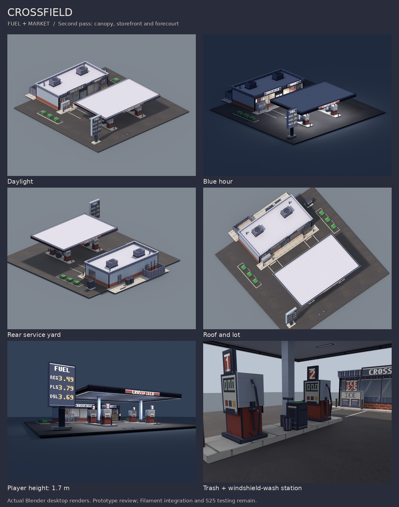

# Crossfield Fuel & Market

An original modern roadside gas station for Timerpg, suited to 2005–2029: four dual-sided pumps beneath a white-membrane canopy with a deep striped fascia and lit perimeter, a brick-base convenience store with lit MARKET signage and window promos, a two-sided price pylon, ice chest, propane cage, island trash/squeegee stations, bollards, air station, and a rear utility yard.

Built against `docs/CHATGPT_MODEL_GUIDE.md`. Prototype asset handoff for review; Filament integration remains separate.



[Daylight](renders/01-day-front-clean.png) · [Blue hour](renders/02-blue-hour-clean.png) · [Rear](renders/03-back-clean.png) · [Above](renders/04-above-clean.png) · [Person height](renders/05-person-height-clean.png) · [Island equipment](renders/06-island-equipment-clean.png)

## Model handoff

- `modern-gas-station.glb`: self-contained glTF 2.0 binary, metres, Y up, entrance facing +Z. Origin is at ground level in the middle of the store's front edge.
- `modern-gas-station.blend`: editable scene with packed textures and a daylight preview camera.
- `model-info.json`: era, dimensions, heights, material names, entrance positions, collision boxes, and swatch provenance.
- `validation.json`: checks of the actual exported GLB, including texture grid, UV scale, triangle counts, materials, doors and collision.
- `build_station.py`, `make_art.py`, `pixel_font.py`: original geometry and station-specific art sources. The window frames, control panels, lettering, louvres and much of the surface detail are painted pixels.

The visible model has **2,964 triangles and 12 materials**. Each pump has **214 triangles**. Its separate collision mesh has 39 boxes / 468 triangles. Meshes are merged by material within the structure, individual pumps, and removable lot group. The store's wall footprint is 17.38 × 8.69 m; the complete site is 32.28 × 35.08 m. See the info file for roof overhangs and heights.

All working textures are drawn or normalized to **2 × 2 texel blocks**, at **0.0388 m per texel**, with nearest filtering and repeat wrapping. The validator measures physical UV scale from the exported triangles rather than relying on a shader setting.

## Runtime notes and unfinished work

These are **Blender desktop renders**, not Filament or S25 captures. Game integration and phone performance validation remain to be done.

- Use `door_main` and `door_back` for entrance interaction. They are ground-level nodes facing outward.
- The mesh named `collision` is **collision-only and must not render**. It carries `collision_only: true` and `render: false` extras. The matching simple boxes are also listed in the info file; Blender Z-up coordinates are explicitly labelled there. Convert `(x,y,z)` to glTF `(x,z,-y)` when using those box centres.
- `lot` holds optional paving, plants, parking paint, the pylon, air station and service-yard dressing. Drop collision boxes tagged `lot` when removing that group. Canopy and pumps remain under `structure`.
- The store contains a floor, walls, ceiling and fixed checkout counter. It deliberately leaves loose furniture to the game's room system. Door openings are clear in the collision model.
- `glass_*` and `glow_*` names identify glazing and nighttime signs/fixtures. Review blending, emissive intensity, lighting, collision placement and world-unit conversion in Filament. Preview area lights and the broad background plane are not in the exported model.
- Price samples are illustrative. The separate `sign_price` node and material let the game update values without changing fixed sign labels or geometry; see the runtime contract below.

## Separate yearly price panel

`sign_price` is an unmerged mesh node under `lot`, with front and reverse faces, and a dedicated material also named `sign_price`. Each face uses the entire UV range 0–1 of `textures/prices.png` (48 × 84 texels / 24 × 42 art pixels). The fixed FUEL and grade labels contain no price digits.

For each simulation year, supply the simulation-owned regular, plus and diesel prices, and bind the resulting texture to **both the base-color and emissive slots** of `sign_price`. These are separate glTF texture entries referencing the same image. Apply the same night emissive intensity as the other station signs to this material. No other model material or geometry needs to change. The art rows start at y=0, 14 and 28, top down, in art pixels; multiply by two for texel coordinates.

```sh
python price_art.py --year 2020 --regular 2.75 --plus 2.95 --diesel 3.05 --output /tmp/prices-2020.png
```

The helper is `price_art.write_prices(path, year, regular, plus, diesel)`. It accepts finite nonnegative values up to 999.99 and uses a narrower original bitmap digit set for longer prices, preserving the 2×2 art grid. It writes only the price PNG, with the year as PNG metadata. Runtime texture binding remains part of Filament integration; the preview defaults are illustrative values for 2025. The validator checks two years, long prices, invalid values, full-panel UVs, both faces, and unchanged fixed-sign artwork.

## Materials and licence

Five catalogue swatches are used: `concrete_office_light`, `metal_corrugated_hotel`, `brick_red_terrace`, `asphalt_plain`, and `sidewalk_cream`. The white roof membrane, enamel accents, window promos and equipment graphics are original pixel artwork in the same palette. Pale trim shares the panel material and the interior shell floor shares the paving material to keep the material count at 12. The guide's swatch atlas was absent from this checkout, so these same swatches were recovered from the repo's committed split source packs using `materials.json` coordinates. See `source-materials/provenance.json` for exact source files and rectangles.

**Material art: LimeZu, https://limezu.itch.io. Game-use licence: Timerpg only; do not redistribute these swatches as a standalone asset pack or use them in unrelated projects.** The station design, geometry, control panels and bitmap sign lettering are original. No real fuel brand or logo is used.

## Rebuild

Requires Blender 4.3.x and Python with Pillow. The committed working textures are sufficient; recovering the source packs is not needed to build the model.

```sh
python make_art.py
blender -b --python build_station.py
python validate_model.py
```

`--draft` produces one smaller daylight view. `--export-only` rebuilds the GLB and metadata without changing the saved preview scene. Validation also requires NumPy.

Optional standard CPU Open Image Denoise cleanup, used for the delivered `-clean.png` previews:

```sh
python -m pip install --target vendor oidn==0.2.1
python finish_renders.py renders/01-day-front.png renders/02-blue-hour.png renders/03-back.png renders/04-above.png renders/05-person-height.png renders/06-island-equipment.png
python package_preview.py
```

Raw renders are retained beside the cleaned versions. The preview cleanup removes path-tracing sampling noise; it does not replace geometry or generate scene contents.
