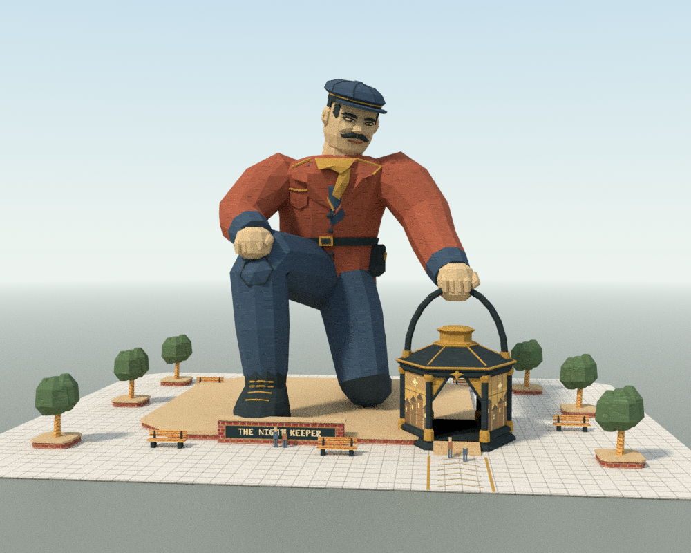

# The Night Keeper

A municipal lamplighter kneels to bring a light down to street level. Seen across the square, his curled hand and the iron carrying hoop outline the lantern. Up close, the lantern is a hexagonal pavilion with two open doorways. Four amber panels show rooflines and stars, like a little town inside its own streetlight.



## Placing the monument

The figure stands 34.34 m high on a 62 × 50 m square. Place the origin on the south sidewalk with the front facing glTF +Z. Inlaid paving leads to two flights of five steps. The lantern floor sits 0.89 m above the plaza. Keep both approaches clear. The south plaque uses the separate `sign_name` panel. Trees and benches can be removed individually. Door nodes and dimensions are in [model-info.json](model-info.json).

The GLB has 8,023 visible triangles and 11 matte materials. The figure uses carved limestone, fired-clay red, indigo, iron and ochre. Brick, pavement and timber derive from the project's shared swatches. All eleven textures use nearest filtering and repeat wrapping at 0.0388 m per texel, with a 2 × 2 block per art pixel.

## Source and review

Use Blender 4.3.2 for the packed source and generator. From this folder in a Timerpg checkout, run the following commands. Python validation uses NumPy and Pillow.

```sh
python make_art.py
blender -b --python-exit-code 1 --python build_model.py
python validate_model.py
blender -b --python-exit-code 1 --python check_source.py
python package_review.py
```

The model builder exports the GLB before adding cameras, people or preview lighting. To regenerate the optional streetscape view, set `KEEPER_REFERENCE_GLB` to the Gazette office GLB and `KEEPER_LIBRARY_GLB` to the 1912 library GLB. The daylight, dusk, pedestrian, detail, rear and overhead views use Blender Cycles. The [early scale study](renders/scale-study.png) used the Gazette at native scale and a camera 1.7 m above the ground. That comparison led to broader stepped wear, stronger coat seams and a clearer cuff silhouette.

The [review sheet](review.jpg) includes a separate [desktop Filament WebGL render](renders/filament.png) of the published GLB. The Khronos validator reported zero errors and warnings. The geometry checks cover texel density, packed images, open portals, supported treads and contact between the carrying hand and hoop. Android/S25 performance, navigation and in-game night lighting still need a device test.
