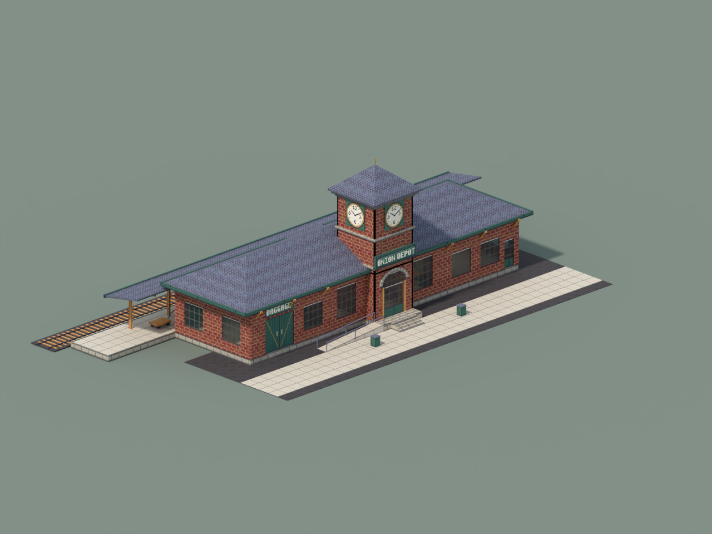

# Union Depot — premier railroad station

An original brick-and-timber passenger depot for Timerpg's developing railway system. A four-face clock tower and stone segmental entrance arch lead into a waiting hall, with a baggage wing, fixed ticket counter and projecting track-observation bay. A 52 m platform and long timber canopy stand behind the building, with hanging station boards, warm lamps, two benches and a baggage cart.

**Blender desktop previews, not Filament game or S25 captures. The tracks in the previews are presentation references and are not exported in the GLB.** The railway implementation was still in progress when this asset was made; no train gauge, rolling-stock clearance, station API, timetable, route or boarding behavior is asserted.



[Six-view review sheet](depot-review.jpg) · [Preview gallery](preview.html)

## Asset and rebuild

- `premier-railroad-depot.glb`: self-contained glTF 2 binary, metres, Y up; street entrance +Z, platform behind it on -Z. Track direction would run along local X.
- `premier-railroad-depot.blend`: packed editable scene saved at the street-side day camera. The clearly named `PRESENTATION TRACK — NOT EXPORTED` collection is preview scenery.
- `model-info.json`: dimensions, era, entrance and platform anchors, collision boxes, clock pivots, name-texture region and implementation notes.
- `validate_model.py` / `validation.json`: checks the actual exported buffers, texture pixels, physical UV scale, atlas containment, modular nodes, door directions and ground height.
- `renders/`: street/day, platform/night, platform/day, above, person height and waiting-hall/ticket-counter views; original and noise-cleaned PNGs.

Run from this directory inside the repository, with Blender 4.3 and Python/Pillow/numpy:

```sh
python make_art.py
blender -b -t 4 -P build_depot.py
python validate_model.py
```

`-- --export-only` skips presentation work. `-- --draft` renders four small exterior checks; `-- --review` renders all six small checks. `-- --shots=02-platform-night` renders selected views. `finish_renders.py` optionally removes render-sampling noise using OIDN 0.2.1; raw images remain available. No lighting is baked into textures or geometry.

## Railway handoff

The architectural style fits roughly 1900–1935 and can survive throughout the game's 1950–2020s timeline. Actual construction, opening, service, closure, reuse and demolition must follow the town simulation. The generic name **UNION DEPOT** does not invent a generated town name or an operating service. The timetable has blank rows; populate it only from real service data.

The body is 34.76 × 12.42 m, the main roof ridge is 8.38 m above ground, and the tower finial is 15.52 m. The platform is 52.15 m long and 4.97 m deep. Its surface is 0.6208 m above forecourt ground, level with the depot floor and every door threshold. The public entrance has four risers and a 1:12 ramp 1.24 m wide. Dimensions are architectural handoff values, not a claim of regulatory certification or implemented navigation.

`rail_platform` is a separate module containing its paving, canopy, columns and signs. Its station-side anchors are `platform_surface`, `platform_west_end`, `platform_east_end`, `boarding_west` and `boarding_east`. They describe the depot, not a finalized rail API. The reference track uses 1.435 m gauge solely to stage the pictures; it is absent from the asset. Match the eventual railroad's centreline, rail head, vehicle envelope, platform edge and boarding points before placing the depot in service. Changing the builder's `F` parameter keeps the depot floor, thresholds and platform level and recalculates the ramp run as `12*F`; check the lot fit when changing it.

`lot` contains forecourt surfacing and independently droppable outdoor props. Entrance steps, ramp and guards belong to `structure`, so dropping the decorative lot retains access geometry. Dropping the platform also requires hiding `platform_bench_*` and `baggage_cart` under `lot`. The waiting hall and offices remain clean shells with fixed counters; the game supplies loose interior furniture.

Eight entrance anchors point outward at their actual threshold level. Their `panel_door_*` groups are separately addressable closed visuals. Hide/open a panel and disable its matching `gate_node` collision box together, restoring both on closure. The current landmark loader may keep them closed. Ticket selling, boarding and room interactions are not implemented by the model.

## Collision and mutable artwork

The collision-only mesh has a complete companion list of 46 boxes. Hide it from rendering. Boxes cover each obstruction from ground to its top, including platform columns, benches, bins, cart and ramp guards. Door gates have their own attachment names. Overhead headers and ceilings are deliberately omitted from walk blocking; use architectural meshes for floor, stair, ramp and detailed arch contact. Raised-floor navigation needs explicit runtime support; boxes alone do not implement an elevation controller.

`sign_station_name` is an isolated material/texture. The three preserved sign nodes use the same 64 × 12 art-pixel name region in a 64 × 16 art-pixel PNG. A future station-name writer can replace that region without changing other signs. Name binding is not yet implemented.

The eight clock hand nodes have pivots at the dial centres and `clock_hand`, `clock_face`, `preview_angle_clockwise_degrees` and `outward_axis_gltf` extras. The preview shows 10:10. To show a target angle, apply the negative of its clockwise delta from the baked preview angle about the outward axis. The existing landmark loader merges materials, so live clock animation requires a runtime extension; the supplied file is a static preview.

## Art and licence

All textures are exact 2 × 2 texel art pixels at 0.0388 m per texel, nearest-filtered and repeat-wrapped. Brick, slate, timber, paving and asphalt use the shared LimeZu swatches; the concrete-block pattern is recoloured to warm stone tones. Exact source rectangles and attribution entries are retained in `source-materials/provenance.json`. These swatches are for Timerpg use only and require their original credit. The geometry, sign lettering, clock dial, door/window panels and terrazzo pixel art are original.
