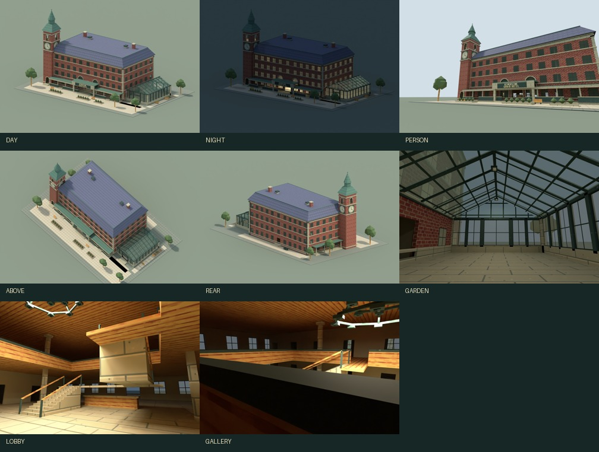

# Riverside Grand Hotel

A city hotel in the 1908 grand-hotel tradition. The corner clock tower marks the entrance from a block away. At street level a raised veranda leads into a two-storey lobby with a return stair, a concierge counter and a chandelier. A separate iron-and-glass winter garden opens onto the terrace. The rear service stair reaches all four hotel floors.

The GLB is in metres, Y up, with the entrance facing +Z. The packed Blender source includes the desktop lighting rig. The four clocks show a fixed time. The nameboard is independently repaintable. Guest-room bays are unfurnished. Placement, hotel operation, the waterway, furniture, navigation and clock animation depend on the game. The eight pictures in [renders](renders/) are desktop Blender renders. Filament and S25 validation are pending.

From this folder, run `python make_art.py`, then `blender -b --python build_model.py`. The build writes raw views to `/tmp/hotel-raw`. Use `python finish_renders.py` with the Python oidn bindings available for the review PNGs. Run `python validate_model.py` against the exported GLB. See [model-info.json](model-info.json) for units, aperture anchors, floor heights and collision boxes. Shared pixel swatches are licensed for Timerpg use.
