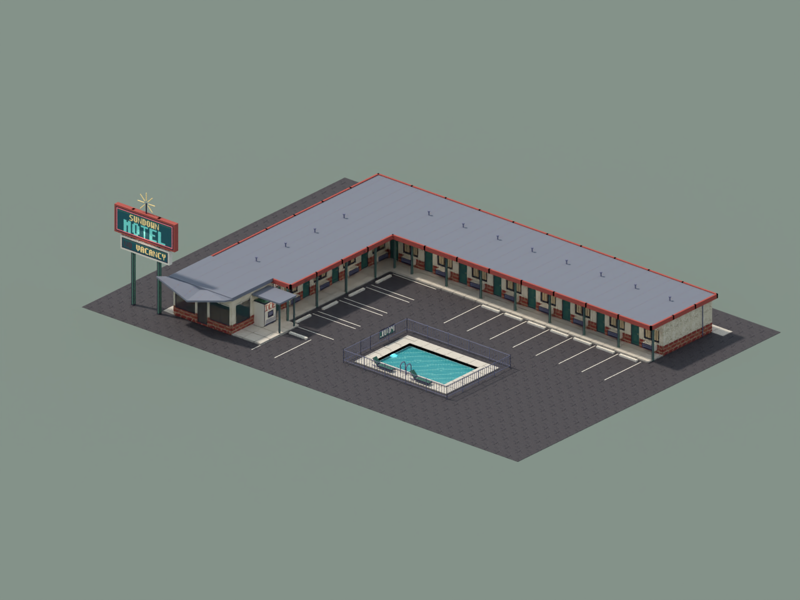

# Sundown Motel

An original 1950s–60s one-storey roadside motor court for Timerpg: **12 separate guest rooms in an L** (eight rear, four side), all opening directly onto the parking court. The office has picture windows, a fixed reception counter, a folded entrance canopy and a tall double-sided neon pylon. A covered ice-machine alcove and small fenced, tiled pool complete the court. The backs have high frosted windows, roof vents, downpipes, a linen/service room, rear apron and bins.

**Actual Blender desktop previews, not Filament game or S25 captures.** This is an architectural asset handoff. Business/occupancy binding, furnishing, vehicle paths, terrain cutting, water rendering and swimming remain game integration work.



[Six-view review](motel-review.jpg) · [Preview gallery](preview.html)

## Files and rebuild

- `roadside-motel.glb`: self-contained glTF 2 binary, metres, Y up, main office entrance +Z. Origin at ground level in the middle of the office front edge. The covered L opens towards the parking court.
- `roadside-motel.blend`: editable source with packed textures, saved at the daytime court camera. Its presentation terrain has a pool opening; presentation lights/terrain are excluded from the GLB.
- `model-info.json`: room bounds, logical IDs, court-facing door anchors, named windows, bathroom placement zones, parking rectangles, collision strategy, sign regions and the pool terrain cutout.
- `validate_model.py` and `validation.json`: checks on the actual exported geometry and embedded texture bytes, plus real sign-writer outputs and parking layout.
- `renders/`: court/day, court/night, rear, above, pool/office at person height, and a clean guest-room shell; raw and noise-cleaned images are retained.

Run from this directory inside the repository, using Python/Pillow/numpy and Blender 4.3:

```sh
python make_art.py
blender -b -t 4 -P build_motel.py
python validate_model.py
```

`-- --review` makes six small checks, `-- --export-only` skips presentation work, and `-- --shots=02-court-night` renders selected views. Optional `finish_renders.py` uses OIDN 0.2.1 to remove light-sampling noise; it does not alter the model. No lighting is baked into materials.

## Name and vacancy panels

The preserved double-sided nodes `sign_name` / `sign_name_back` use the isolated `sign_name` material and a **80 × 28 art-pixel** region inside a 128 × 32 art-pixel PNG. The upper line is the explicit short motel name; MOTEL is the fixed second line. `sign_art.write_name(path, name)` rejects unsupported or overlong text instead of stretching or silently truncating it.

`glow_vacancy_panel` / `glow_vacancy_panel_back` share the isolated `glow_vacancy` material and a **64 × 12 art-pixel** region. `textures/vacancy.png` leaves NO dark; `textures/no-vacancy.png` lights NO while VACANCY remains lit. `sign_art.write_vacancy(path, occupied)` changes only the NO letters. Tests verify that it leaves the rest of the panel and the name artwork unchanged.

For an exported preview with a different explicit name or the full state:

```sh
blender -b -P build_motel.py -- --name=SUNSET --occupied --export-only
```

The default preview is SUNDOWN with NO off. This is artwork, not a claim about a simulated booking. The runtime must derive the actual name and availability from its business/occupancy facts. The file does not create a business, book rooms, set room prices or open a motel automatically.

## Rooms, court and ice machine

Room IDs `room_01`–`room_12` are logical metadata identifiers; each has a real separate entrance, named window, floor bounds and bathroom placement zone. The shells share merged architectural materials, while the 12 window nodes and individual `panel_door_room_*` groups remain addressable. Inside are carpet, walls, ceilings and high rear windows. The game supplies beds, other loose furniture, bathroom partitions and fixtures. The office includes its fixed counter; the corner service/linen room has its own rear entrance.

All guest doors face the court. Door and floor levels are 0.1552 m above the asphalt, matching the covered walkways. The default door panels are closed. Open/hide a panel and disable its matching `gate_node` collision box together; restore both when closing it. The current loader may keep panels closed and merge window lighting, so live occupancy-driven doors and per-room lighting require a runtime extension.

Twelve parking templates are provided: seven rear bays, four side bays and one front/check-in bay. Their bounds do not overlap each other or the fenced pool. No cars are baked in. Vehicle paths and turning clearance remain the traffic system's responsibility.

`ice_machine` is a separate static prop under `lot`, with its own cream cabinet, ICE face, dispensing recess, vent grille and cover. Dispensing logic is not implemented. The small exterior objects all stay under the prop triangle budget.

## Pool and terrain

The water area is about **7.45 × 4.35 m**, with coping, a tiled sloping basin, metal fence, separate closed gate, ladder and two outdoor loungers. The nominal water depth ranges from 0.93 to 1.71 m. These are model dimensions, not a certification or a working swimming system.

The sunken water surface is below grade. The asset's asphalt/deck geometry has a real opening, and `model-info.json` supplies its exact rectangle: Blender art coordinates `[200,48,296,104]` (one art pixel = 0.0776 m). **The game must cut or mask its own terrain there before placing the motel. The GLB cannot carve TownGround automatically.** Current opaque landmark rendering also needs a dedicated water/alpha treatment if the basin is to show through the surface.

Keep `pool_gate` and its gate box closed until traversal is supported. The gate is independently addressable; no opening/swimming behavior is implemented. Dropping `lot` removes its pool, surfacing and yard props together, leaving the town's ground. Hiding only `pool` requires a replacement ground patch over the opening.

## Collision and art contract

The guide permits **“use the walls.”** This model uses a hybrid: architectural walls, closed door meshes and attached AC housings provide structural collision; the hidden `collision` mesh and companion list add **44 full-height boxes** for doors, columns, pool barriers, sign posts, ice machine and yard props. The ladder's box deliberately reaches below grade to cover its submerged portion. Overhead sign faces are not ground-level walk barriers. Consumers must keep mesh-derived collision and explicit gate boxes synchronized when hiding doors or opening the pool gate.

Use actual floor/rim/step surfaces for elevation contact. Hide the collision mesh from rendering. Remove attachment/group boxes when their geometry is dropped. `lot` includes the pool and its props; the motel structure and sign remain separate. A consumer that omits the lot must provide its own forecourt/walkway surfacing at the documented thresholds.

There are twelve role-named materials. Every embedded PNG uses exact 2 × 2 texel art pixels, mapped at 0.0388 m per texel, with nearest/repeat sampling. The shared LimeZu atlas supplies stucco (retinted cream), brick, grey roof membrane, paving and asphalt; exact source entries are retained in `source-materials/provenance.json`. These materials are licensed for Timerpg use only and require their original credit. The geometry, neon lettering, door/window panels, pool tiles/water pattern, carpet and equipment art are original.
