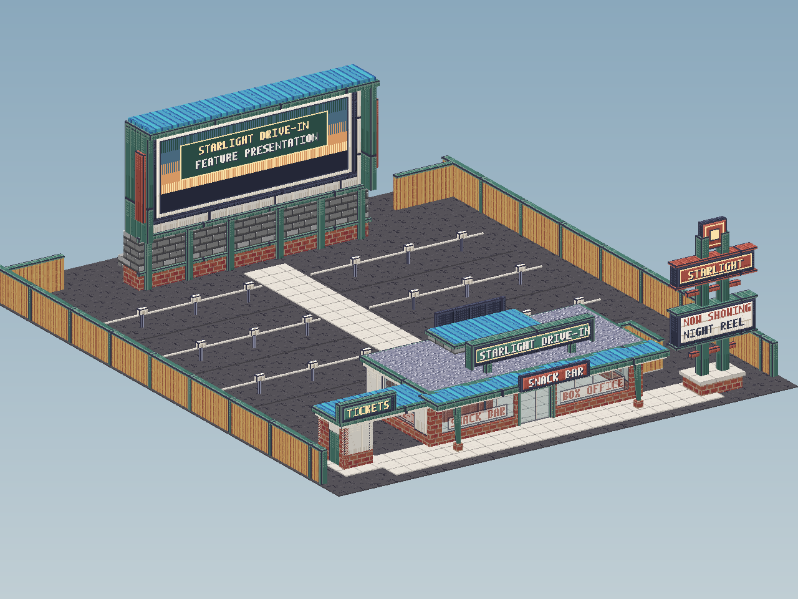
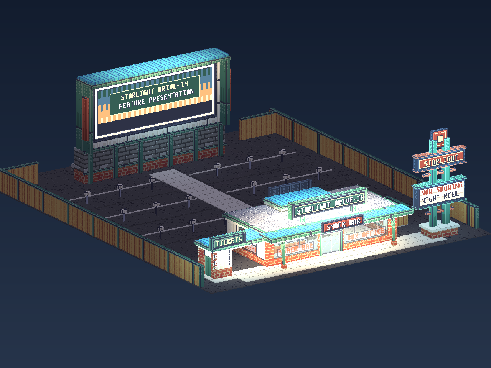
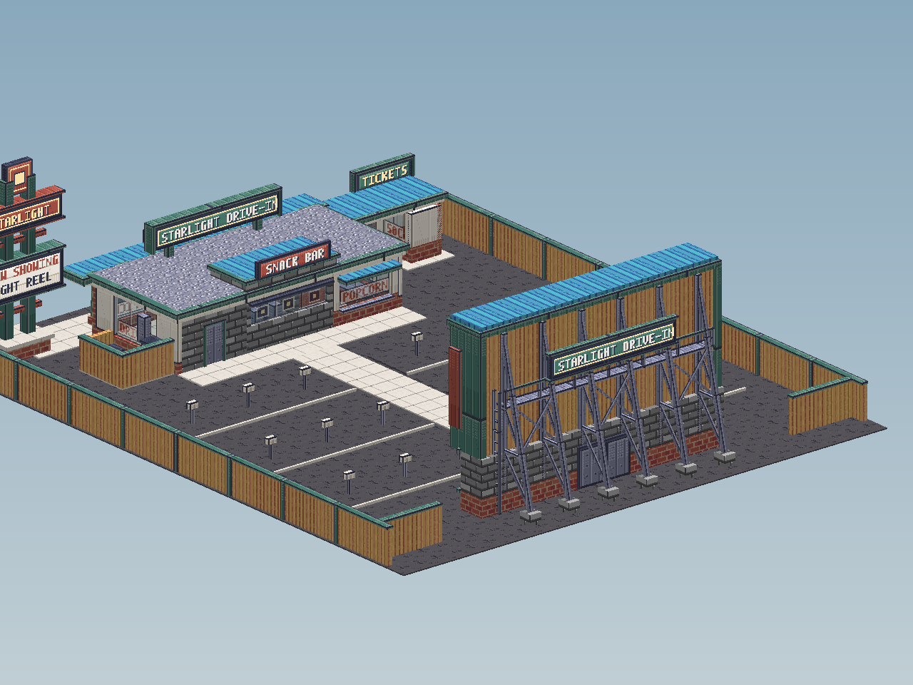

# Starlight Drive-In

An original 1950s Googie drive-in movie theater landmark for Timerpg: cantilevered concession and optical projection pavilion, glazed drive-through ticket island kiosk, monumental widescreen cinema tower with six rear steel A-frame raker trusses and elevated service catwalk, three tiered viewing berm ramps with 18 dual-speaker stanchion posts, perimeter timber headlight-shield fence, and a double-sided roadside neon marquee pylon.





[Six-view review sheet](starlight-review.png) · [Preview gallery](preview.html)

## Files and rebuild

- `starlight-drive-in.glb`: self-contained binary glTF 2.0 model, metres, Y-up, front entrance facing `+Z`; origin `(0, 0, 0)` at ground level in the horizontal center of the front concession pavilion edge (`z = 0`).
- `model-info.json`: dimensions, heights, era, material roles, optional prop groups, 57 Blender Z-up collision boxes, entrances, and runtime handoff notes.
- `validation.json`: automated contract verification of the exported `.glb`, checking physical UV density (`0.0388 m/texel`, max error `3.3e-6 m` across all 12,894 triangle edges), `2×2` texel art-pixel blocks on all 12 embedded PNGs, `detail_utility` quadrant boundaries, triangle budgets, door orientations, and front entrance collision clearance.
- `renders/`: seven `1280×960` 3D views covering front daylight, blue hour, rear 360° structure, plan/above, street person-height (`1.75 m`), interior concession/projection shell, and widescreen tower close-up.
- `textures/` and `source-materials/`: 12 pixel-art textures and `provenance.json` documenting the seven shared LimeZu swatches cut directly from `kotlin-street/tools/swatches/atlas/atlas.png`.

Rebuild and validate from scratch:

```sh
python3 make_art.py
python3 build_model.py
python3 validate_model.py
node render_views.mjs
python3 package_preview.py
```

## Game handoff

Design period 1950–1966; suggested opening 1956. Continued operation, twin-screen expansion, seasonal closure, or redevelopment must follow simulation history. The front concession and projection pavilion measures `16.14 × 7.45 m` (`208 × 96` art pixels), the rear screen tower spans `17.85 × 5.74 m` (`230 × 74` art pixels) at `11.33 m` height (`146` art pixels), and the full optional lot measures `34.76 × 42.21 m` (`448 × 544` art pixels), peaking at `11.48 m` (`148` art pixels, within the `12.0 m` contract maximum) at the crown of the roadside marquee pylon. All ground paving and asphalt stand at `y >= 0.0 m` so the lot never sinks below town ground.

The pavilion interior is a clean architectural shell (`floor_terrazzo` / `ground_paving` floor slab, cream ceiling soffit with six downward-facing `glow_signage` lamp panels that automatically spawn real downward `ceilingLights` in `LandmarkKit`, a built-in coral-and-stainless L-shaped concession counter shell on the west side, and a concrete-block optical projection room on the east rear side housing twin projector pedestals and three glass optical ports aimed `-Z` at the widescreen tower). No loose furniture or cars are bundled in the mesh.

The separate `speaker_posts` hierarchy under `lot` contains **18 individual dual-speaker stanchion posts** (`speaker_post_01` through `speaker_post_18`, six posts across each of the three tiered viewing ramps). Each post node has its local pivot at the post base on the ramp (`y = 0.1552 m`), uses 24 triangles (`432` triangles across the entire `speaker_posts` group, well under the `< 500` prop limit), and carries `gameplay_prop: "speaker_post"`, `ramp` (`1..3`), and `post_slot` (`1..6`) extras for runtime vehicle parking alignment.

`door_main` (`[0.0, 0.0, 0.1552]`, facing `+Z`), `door_back` (`[5.432, 0.0, -7.6048]`, facing `-Z`), and `door_side` (`[-14.8992, 0.0, -0.9312]`, facing `-X` into the ticket booth) are ground-level outward-facing empty leaf nodes with `interaction: "Go inside"`. Corresponding `door_panel_main`, `door_panel_back`, and `door_panel_side` geometry nodes are independently hideable closed visuals; hide a panel node and drop its `gate_node` collision box together when an interaction opens that doorway.

The `collision` mesh is **collision only** (`extras: {"collision_only": true, "render": false}`): suppress it in rendering and use its 57 full-height metadata boxes in `model-info.json` (`collision.boxes_blender_z_up`) for walkability. The optional `lot` hierarchy contains the asphalt pad, tiered viewing ramps, perimeter timber light-shield fence, `marquee_pylon` (`200` triangles), `service_yard` (`152` triangles), and `speaker_posts` (`432` triangles). Drop collision entries by `attachment` when hiding an optional prop group, and drop all `group: "lot"` entries when placing the building without its lot.

## Art and provenance

One art pixel is `2 × 2` texels at `0.0388 m` per texel (`1 art pixel = 0.0776 m`). All embedded PNGs use `NEAREST` filtering (`magFilter: 9728`, `minFilter: 9984`) and `REPEAT` wrapping (`10497`).

Red brick (`brick_red`), concrete block courses (`block_courses`), gravel roof ballast (`ballast`), blue ribbed metal roofing (`roof_tin_blue`), vertical timber siding (`plank_vertical`), worn asphalt (`asphalt_worn`), and concrete paving (`pavement`) are cut directly from Timerpg's shared LimeZu swatch atlas (`kotlin-street/tools/swatches/atlas/atlas.png`), with exact atlas coordinates recorded in `source-materials/provenance.json`. The porcelain cream panels, Googie teal fascia, four-quadrant utility atlas (`utility.png`), storefront/projection glazing (`glass.png`), and neon marquee & widescreen dusk intermission artwork (`signs.png`) are original pixel art painted at 1x art resolution and enlarged 2x via nearest-neighbor.
