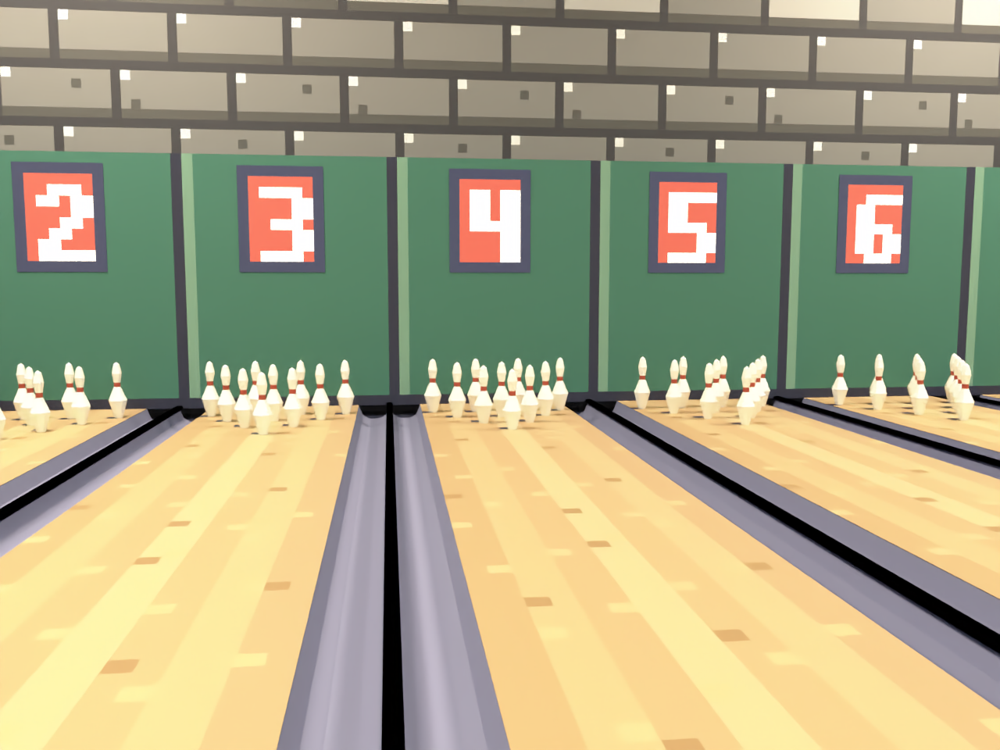

# Starling Lanes

An original 1960s eight-lane bowling alley for Timerpg: faceted barrel-vault hall, folded wing canopy, illuminated pixel lettering, twelve-sided bowling-pin sculpture, glazed lobby, ceramic mosaic piers and high side windows. The back includes mechanical plant, downpipes, a service exit and a brick-screened bin yard.

**The images are Blender desktop renders, not Filament game or Samsung S25 captures.** This is an asset handoff, not a working bowling minigame or an integrated landmark.




[Six-view review sheet](starling-review.jpg) · [Preview gallery](preview.html)

## Files and rebuild

- `starling-lanes.glb`: self-contained glTF 2 binary, metres, Y up, front +Z; origin at ground level in the middle of the front building edge.
- `starling-lanes.blend`: packed-texture editable source, saved at the day-front presentation camera.
- `model-info.json`: dimensions, heights, era, collision boxes, entrances and runtime handoff.
- `validation.json`: automated checks on the exported GLB, including physical UV density and actual embedded image pixels.
- `renders/`: seven views covering front/day, blue hour, rear, above, person height, interior overview and pin-deck close-up.

Rebuild using Python with Pillow and Blender 4.3:

```sh
python make_art.py
blender -b -t 4 -P build_model.py
python validate_model.py
```

`-- --shots=02-blue-hour,04-above` renders selected views. `-- --draft` produces one smaller preview; `-- --export-only` rebuilds the GLB and metadata without rendering. Render cleanup uses optional Open Image Denoise via `finish_renders.py`; original rendered PNGs are retained beside the cleaned previews.

## Game handoff

Design period 1960–1969; suggested opening 1964. Continued operation, reuse, rebranding or demolition must follow simulation history. This does not add a business kind or create an owner. The building is 22.35 × 31.04 m; its optional parcel is 34.76 × 42.21 m, suitable for a larger town parcel.

The second-pass interior uses quieter honey-maple boards, seven staggered aiming arrows per lane, approach alignment dots, black foul lines, actual lowered six-facet gutters, gutter edge caps, ten-pin deck spots and numbered masking panels. The 1.0864 m lane beds run approximately 18.31 m from foul line to headpin. Their surface is 0.1164 m above the base floor, reached by a short approach ramp. These are art-grid approximations, not certified competition dimensions.

The separate `bowling_equipment` hierarchy contains **80 individual white pins with red neck bands** (eight triangular ten-pin racks), plus four paired ball-return assemblies with red and teal bowling balls. Each pin node has its origin at its foot and carries `lane` and `rack_slot` extras; each pin is 94 triangles and each return assembly is 156. The group is optional and can be removed when the game supplies its own equipment. These are static handoff props: scoring, ball motion, pin physics and pinsetter animation remain runtime work. Loose seating and shoes still come from the game's furniture system.

`door_main`, `door_side` and `door_back` are ground-level outward-facing interaction anchors. Corresponding `door_panel_*` groups are independently addressable closed visuals. Open/hide a panel and disable its `gate_node` collision box together when the game unlocks that door. Re-enable both on closure. No doorway interaction is implemented here.

The `collision` mesh is **collision only**: suppress it in rendering and use its 41 metadata boxes for traversal. The GLB extras explicitly mark it non-rendering; glTF viewers that ignore custom extras must hide it manually. The boxes include glass walls, fixed counter, rear mask, floor, columns and the lobby ceiling. Use actual architectural meshes if full vault ceiling collision is needed. The optional `lot` hierarchy contains paving and markings; `giant_pin` and `service_yard` are separately droppable. Remove collision entries by attachment when dropping a prop, and all `group: lot` entries when dropping the lot. Remove `group: equipment` collision entries when hiding `bowling_equipment`. Raised lane beds and the approach have their own floor boxes; use the actual ramp mesh for sloped contact or support the 0.1164 m step in the player controller.

The twelve materials merge meshes by material within these functional groups. Window and sign names identify the materials for runtime lighting. Blender presentation lights are excluded from the GLB: the game supplies illumination. No lighting is baked into the geometry or textures.

## Art and provenance

One art pixel is 2 × 2 texels, at 0.0388 m per texel. PNGs use nearest filtering and repeat wrapping. UV checks cover every exported visible triangle edge.

Brick, concrete block, blue metal roofing, asphalt and pavement use Timerpg's shared LimeZu atlas swatches; exact rectangles and source entries are recorded in `source-materials/provenance.json`. These materials are licensed for Timerpg game use only; keep their original credit. The new maple lane finish, inlays, supplemental enamel, ceramic mosaic, window art, signs and mesh geometry are original. The original plank swatch is retained as a credited reference for the first-pass floor. The model uses no downloaded geometry, external typeface, real brand, baked GI or photographic texture.
