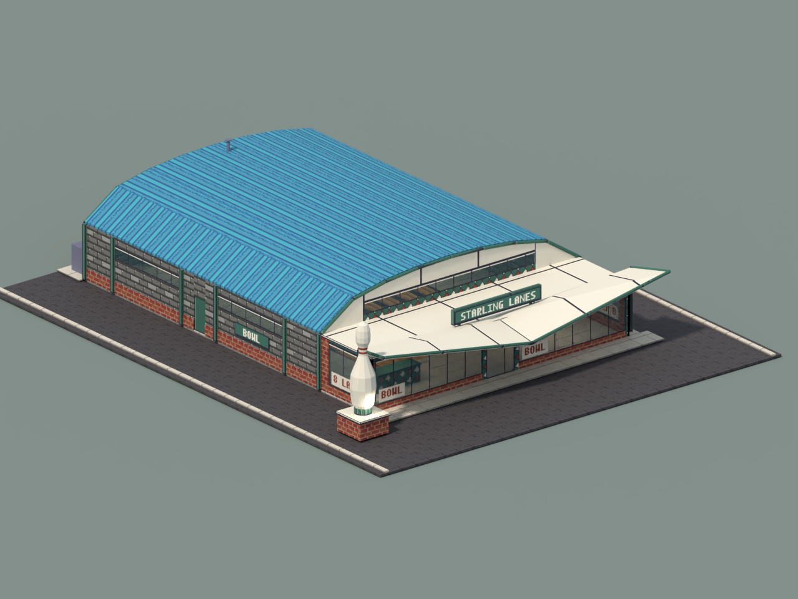

# Starling Lanes

An original 1960s eight-lane bowling alley for Timerpg: faceted barrel-vault hall, folded wing canopy, illuminated pixel lettering, twelve-sided bowling-pin sculpture, glazed lobby, ceramic mosaic piers and high side windows. The back includes mechanical plant, downpipes, a service exit and a brick-screened bin yard.

**The images are Blender desktop renders, not Filament game or Samsung S25 captures.** This is an asset handoff, not a working bowling minigame or an integrated landmark.



[Six-view review sheet](starling-review.jpg) · [Preview gallery](preview.html)

## Files and rebuild

- `starling-lanes.glb`: self-contained glTF 2 binary, metres, Y up, front +Z; origin at ground level in the middle of the front building edge.
- `starling-lanes.blend`: packed-texture editable source, saved at the day-front presentation camera.
- `model-info.json`: dimensions, heights, era, collision boxes, entrances and runtime handoff.
- `validation.json`: automated checks on the exported GLB, including physical UV density and actual embedded image pixels.
- `renders/`: six views covering front/day, blue hour, rear, above, person height and interior.

Rebuild using Python with Pillow and Blender 4.3:

```sh
python make_art.py
blender -b -t 4 -P build_model.py
python validate_model.py
```

`-- --shots=02-blue-hour,04-above` renders selected views. `-- --draft` produces one smaller preview; `-- --export-only` rebuilds the GLB and metadata without rendering. Render cleanup uses optional Open Image Denoise via `finish_renders.py`; original rendered PNGs are retained beside the cleaned previews.

## Game handoff

Design period 1960–1969; suggested opening 1964. Continued operation, reuse, rebranding or demolition must follow simulation history. This does not add a business kind or create an owner. The building is 22.35 × 31.04 m; its optional parcel is 34.76 × 42.21 m, suitable for a larger town parcel.

The interior has a continuous floor, fixed shoe-rental counter, approach, eight floor lane inlays, ceiling fixtures and a pinsetter masking wall. It deliberately contains no loose seating, balls, pins or shoes. The game supplies furniture, equipment, scoring and animation. Playing lanes are approximately 18.31 m long; no certified competition dimensions are claimed.

`door_main`, `door_side` and `door_back` are ground-level outward-facing interaction anchors. Corresponding `door_panel_*` groups are independently addressable closed visuals. Open/hide a panel and disable its `gate_node` collision box together when the game unlocks that door. Re-enable both on closure. No doorway interaction is implemented here.

The `collision` mesh is **collision only**: suppress it in rendering and use its 28 metadata boxes for traversal. The GLB extras explicitly mark it non-rendering; glTF viewers that ignore custom extras must hide it manually. The boxes include glass walls, fixed counter, rear mask, floor, columns and the lobby ceiling. Use actual architectural meshes if full vault ceiling collision is needed. The optional `lot` hierarchy contains paving and markings; `giant_pin` and `service_yard` are separately droppable. Remove collision entries by attachment when dropping a prop, and all `group: lot` entries when dropping the lot. The ground surface itself is flat.

The twelve materials merge meshes by material within these functional groups. Window and sign names identify the materials for runtime lighting. Blender presentation lights are excluded from the GLB: the game supplies illumination. No lighting is baked into the geometry or textures.

## Art and provenance

One art pixel is 2 × 2 texels, at 0.0388 m per texel. PNGs use nearest filtering and repeat wrapping. UV checks cover every exported visible triangle edge.

Brick, concrete block, blue metal roofing, asphalt, pavement and wood use Timerpg's shared LimeZu atlas swatches; exact rectangles and source entries are recorded in `source-materials/provenance.json`. These materials are licensed for Timerpg game use only; keep their original credit. Supplemental enamel, ceramic mosaic, window art, signs and mesh geometry are original. The model uses no downloaded geometry, external typeface, real brand, baked GI or photographic texture.
