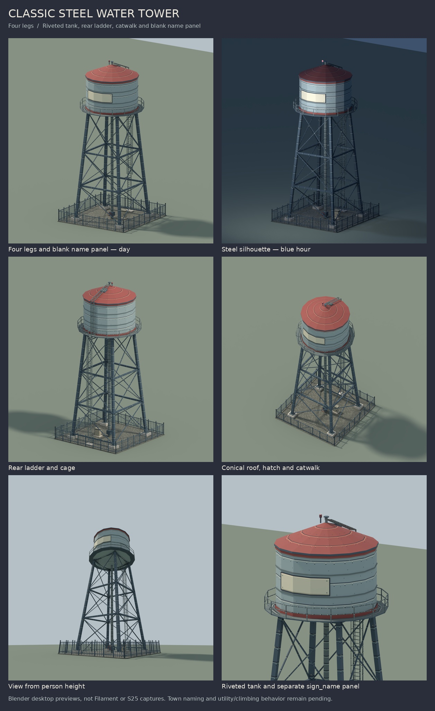

# Classic steel water tower

An original four-legged municipal water tower for Timerpg: a riveted, sixteen-sided pale steel tank, muted red conical roof and trim, tapered steel legs with three levels of X-bracing, concrete anchor pedestals, a central wet riser and valve, a catwalk with guardrails, and a rear caged ladder continuing onto the tank roof. The **blank `sign_name` panel** is an independently preserved mesh and material on the front of the tank. No town name, real brand or lettering is baked into it.

Typical construction: **1920–1965**, appropriate as an existing landmark from the 1940s into the present. Approximately **26.23 m tall**, with an **8.38 m diameter tank** and a **12.73 × 12.73 m fenced compound**. The base has a gravel service pad, visible closed maintenance gate and a small control cabinet.



**These are actual Blender desktop previews, not Filament game or S25 captures.** The model is an asset prototype; runtime utility simulation, town-name text and climbing are not implemented.

## Files and rebuild

- `water-tower.glb`: self-contained glTF 2 binary, metres, Y up, front gate facing +Z. Origin at grade at the front edge of the pad, two art pixels ahead of the gate.
- `water-tower.blend`: editable source with packed PNGs, saved at the daylight front camera. Presentation terrain/lights/cameras are excluded from the GLB.
- `build_tower.py`, `make_art.py`: original deterministic geometry and art sources.
- `model-info.json`: dimensions, four leg node IDs, ladder reference, exact sign region and collision box.
- `validate_model.py`, `validation.json`: checks of the actual exported buffers, all material textures, physical UV scale, outward catwalk surface, blank panel, four legs and full-height collider bounds.
- `renders/`: six views (day, blue hour, rear, above, person height and tank detail), raw and noise-cleaned.
- `preview.html`: local review gallery and model/source links.

From this folder inside the repository, with Blender 4.3 and Python/Pillow/numpy:

```sh
python make_art.py
blender -b -t 4 -P build_tower.py
python validate_model.py
```

`-- --review` renders small checks; `-- --shots=01-front-day` renders selected views; `-- --shots=none` exports the model and packed source without rendering. Optional `finish_renders.py` uses OIDN 0.2.1 to remove sampling noise, then `package_preview.py` builds the review sheet, gallery and local ZIP. It does not create or change model details. No lighting is baked into textures.

## Blank name panel

The exact mesh **`sign_name`** and material **`sign_name`** remain separate from the tank. The front panel follows three tank facets. The PNG is 128 × 64 texels (64 × 32 art pixels); the active region is **`[0,0,64,20]` art pixels**, with a thin outline, top highlight and four small corner fasteners. The central field is blank. It is deliberately a non-emissive name panel, not a lit sign.

Its developed chord width is **4.9664 m**, height **1.552 m**, mapped at **0.0388 m per texel**. Keep its current UVs when writing a name. Draw only whole 2 × 2 texel art pixels inside the blank inset, preserve the border/fasteners, and fit supported names without stretching the grid. A developer may choose wrapping or a shorter label for overlong names; this asset supplies no text writer or generated town name. The texture's unused lower rows are outside the panel UV region.

## Collision and access

The fenced maintenance compound is intentionally **closed and non-walkable**. A single hidden `collision` box encloses the entire compound from grade to the marker beacon; its centre, size, group and attachment are listed in `model-info.json`. Validation checks every visible vertex is inside it. This avoids pretending that the many slender diagonals already provide a usable climbing/navigation mesh.

Keep `service_gate` closed. To admit a player, replace this compound exclusion box with detailed leg/bracing/pipe/fence/gate collision and navigation before opening the gate. The rear `access_ladder` is a **maintenance reference only**, not a `door_main` or “Go inside” entrance. There is no inhabitable interior, door interaction or climbing implementation. The ladder cage, landing rail opening, mounting crossbars and roof hatch are visual geometry.

`lot` contains only the gravel pad and can be dropped. Footings, fence and gate remain with the structure, so removing `lot` does not leave its collider blocking an apparently open area. Ground surfaces are at or above zero. The game must hide the `collision` mesh when drawing the GLB.

## Art and runtime handoff

**9,210 visible triangles, nine materials**, four preserved leg meshes; other geometry is merged by material inside tank, ladder, gate, structure and lot assemblies. Cylinders use eight or sixteen sides with flat facets. All PNGs have exact 2 × 2 texel art-pixel blocks and nearest/repeat sampling; UVs use metres per texel without stretching, including the three-facet name panel.

The shared LimeZu `pavement` swatch supplies the concrete footings and is retained with provenance in `source-materials/`. It is licensed for Timerpg only and requires the original credit. Steel plate courses, rivets, paint chips, gravel, equipment and the blank panel are original pixel art using the existing muted town palette.

The steady red `glow_beacon` is an emissive visual marker; no blinking, aviation, electrical, water pressure, storage or supply behavior is implemented. The blue-hour render uses presentation fill lighting; it is not a claim that the tower carries floodlights or has been tested on the S25. The developer should bind actual town naming and utility state to simulation facts during integration.
